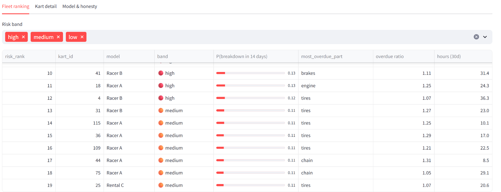
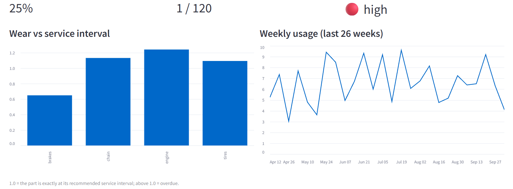
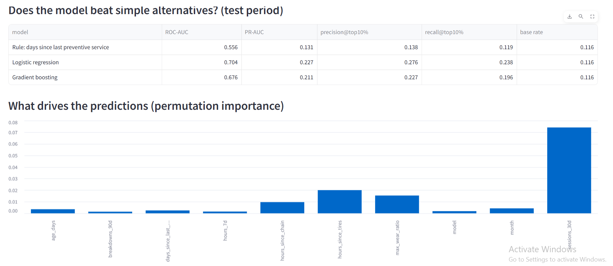

# KartMaint Analytics: predictive-maintenance big-data pipeline

An end-to-end data pipeline that turns raw maintenance and usage records into a per-kart
**"probability of breakdown in the next 14 days"**, shown in a Dockerized dashboard.

> **Data is SIMULATED.** A generator creates a fictional karting fleet (parts wear with hours of use,
> breakdown risk grows as a part becomes overdue for service). No real client data is used.
> Results show that the pipeline works end to end, **not** how it would perform on a real fleet.

## Architecture

```
generate_data.py      PostgreSQL (raw tables, dirty on purpose)
        |                    |
        v                    v  Spark JDBC
   CSV export  ------->   etl.py   (PySpark: validate, dedupe, normalise, impute)
                             |
                             v   data/clean/{sessions,events}/year=/month=   (partitioned Parquet)
                        features.py (PySpark window functions, daily kart grid)
                             |
                             v   data/features/{train_set,latest}
                         train.py (scikit-learn, time-based split)  ->  data/model/
                             |
                         score.py (batch scoring)  ->  data/predictions/latest_scores.parquet
                             |
                      dashboard/app.py (Streamlit)  http://localhost:8501
```

| Stage | Tech | What it does |
|---|---|---|
| Raw storage | PostgreSQL 16 | `karts`, `sessions`, `maintenance_events` (duplicates, typos, nulls, impossible values injected) |
| ETL | PySpark | Counted cleaning rules written to `data/clean/dq_report.json`; partitioned Parquet output |
| Features | PySpark windows | Rolling usage, hours since each part was serviced, failure history, `max_wear_ratio` |
| Model | scikit-learn | Logistic regression vs gradient boosting vs a naive rule, chosen on validation |
| Serving | Streamlit + Docker | Fleet ranking, per-kart drill-down, model honesty tab |

## Screenshots

**Fleet ranking:** karts sorted by estimated probability of a breakdown in the next 14 days.



**Kart detail:** wear of each part against its recommended service interval, and recent usage.



**Model and honesty:** the model compared with simple alternatives, and what drives its predictions.



## Quick start

**With Docker** (PostgreSQL + Spark inside containers):

```bash
# Linux / macOS / Git Bash
./run_pipeline.sh
# Windows PowerShell
./run_pipeline.ps1

docker compose up dashboard      # open http://localhost:8501
```

**Without Docker** (CSV instead of PostgreSQL; needs Python 3.10-3.12 and Java 17+):

```bash
bash run_local.sh
streamlit run dashboard/app.py
```

Tests: `python -m pytest -q` (11 tests, about 40 s, runs a small Spark pipeline).

## Design decisions (and why)

* **No leakage.** For day D every feature uses only data up to the end of day D-1 (window frames end at -1).
  `tests/test_features.py` re-computes features in plain pandas on random rows and compares them with Spark.
* **Time-based split**, not random: train < validation < test in chronological order, with a 14-day gap
  because labels look 14 days ahead.
* **Imbalanced target (~9% positives):** we report PR-AUC and precision/recall in the top 10% of risk
  scores. Accuracy would be meaningless. No class re-weighting, so probabilities stay roughly calibrated.
* **Baselines:** a naive rule and logistic regression. A complex model must beat them to be selected.
* **Partitioned Parquet** (`year/month`) for cheap time-range scans; the daily grid is built in Spark,
  so the same code scales to many more karts (`--karts 2000`).
* **Explicit data-quality report** instead of silent cleaning.

## Reference results (seed 42, 120 karts, test period Feb-Sep 2026)

| Model | ROC-AUC | PR-AUC | Precision in top 10% | Base rate |
|---|---|---|---|---|
| Rule: days since last preventive service | 0.556 | 0.131 | 13.5% | 11.6% |
| **Logistic regression (selected)** | **0.704** | **0.227** | **27.6%** | 11.6% |
| Gradient boosting | 0.676 | 0.211 | 22.7% | 11.6% |

Reading it honestly: the model ranks karts about **2.4x better than chance** in the top decile, and clearly
better than the naive rule. Recent usage (`sessions_30d`) and wear (`hours_since_tires`, `max_wear_ratio`) are
the most important features. Breakdowns are rare random events, so the ceiling is limited. Run your own
pipeline and paste YOUR numbers from `data/model/metrics.json`.

## Limitations

* Simulated data: results reflect the simulator's assumptions (wear-driven hazard), not reality.
* History before the first record is unknown (left-censored), so early `hours_since_*` values are approximate.
* The selected model slightly under-predicts in the test period (mean predicted 8.2% vs 11.6% actual),
  because of seasonality. A production system would recalibrate periodically.
* No drift monitoring, scheduling (Airflow/cron) or model registry. These are natural next steps.

## Project layout

```
kartmaint/   config, generate_data, etl, features, train, score, spark_utils
dashboard/   Streamlit app
sql/         PostgreSQL schema
tests/       pytest suite
docs/        INTERVIEW_NOTES.md (how to explain every design choice)
```
